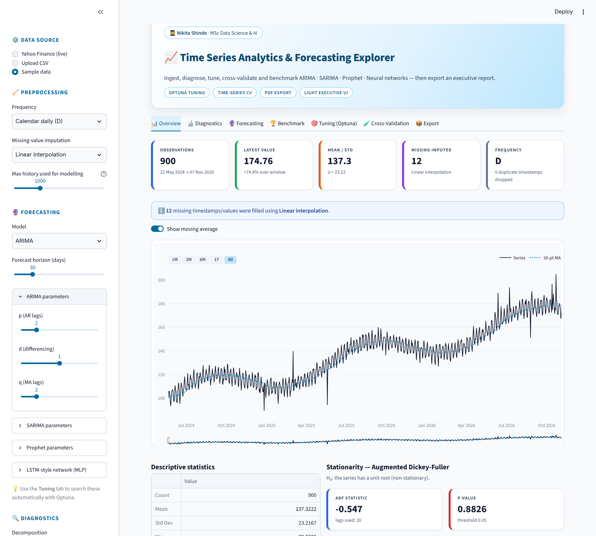
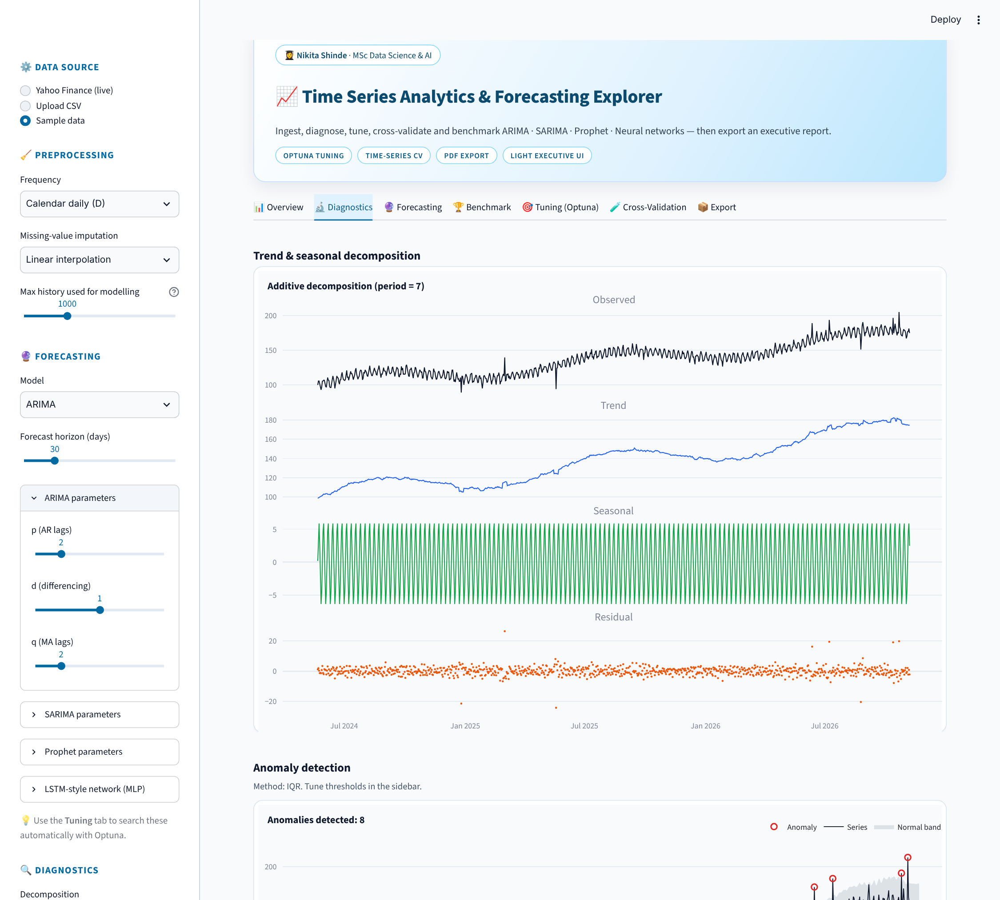
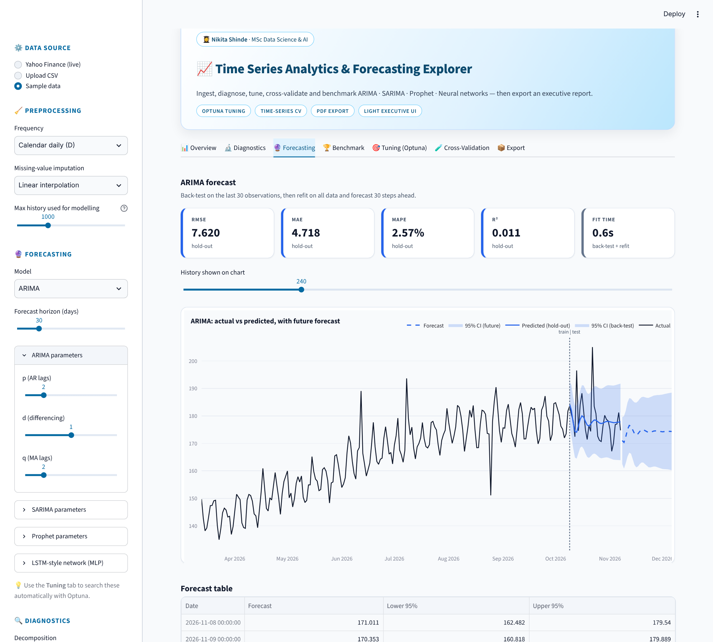
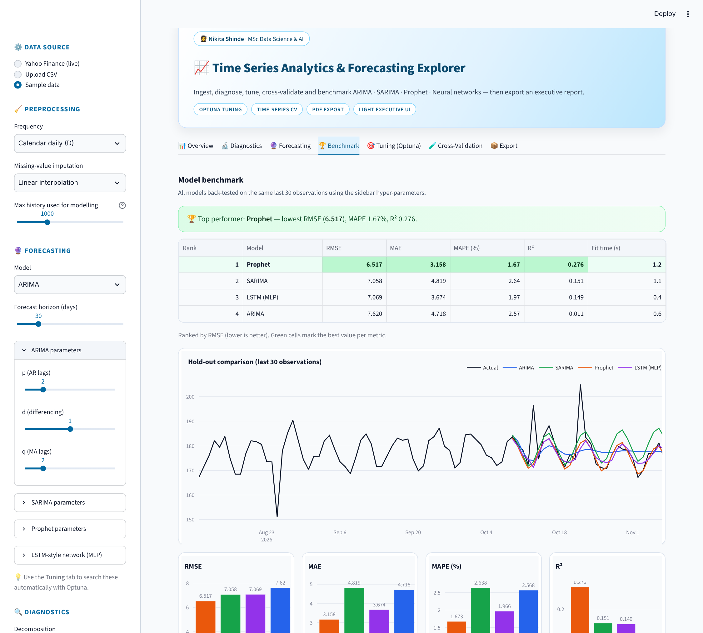
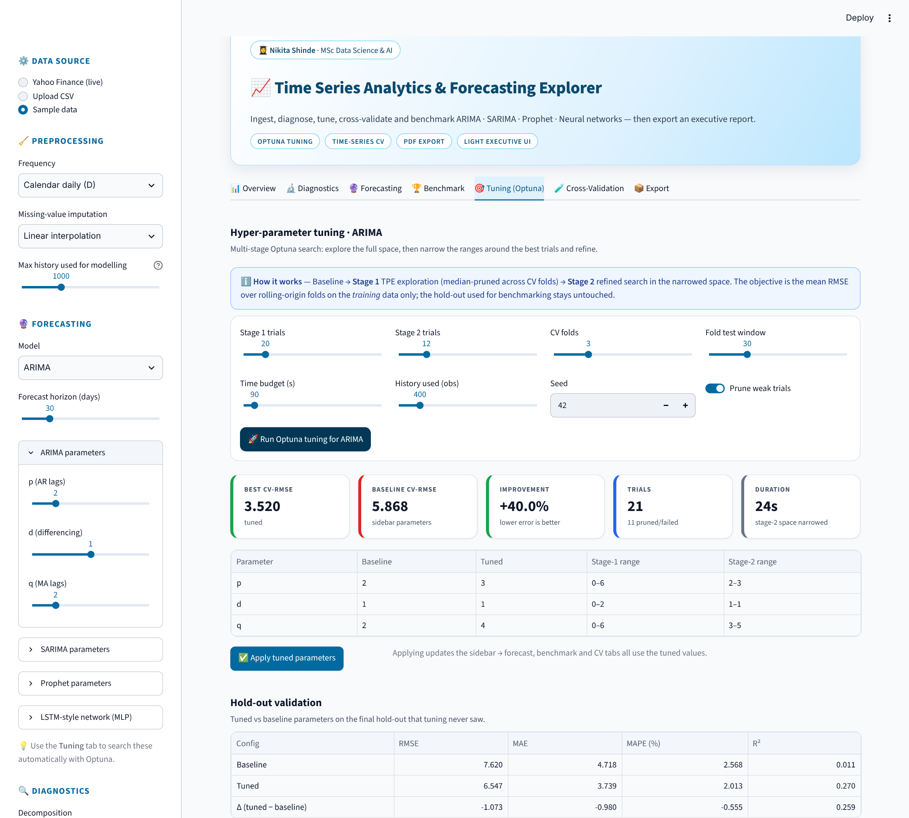
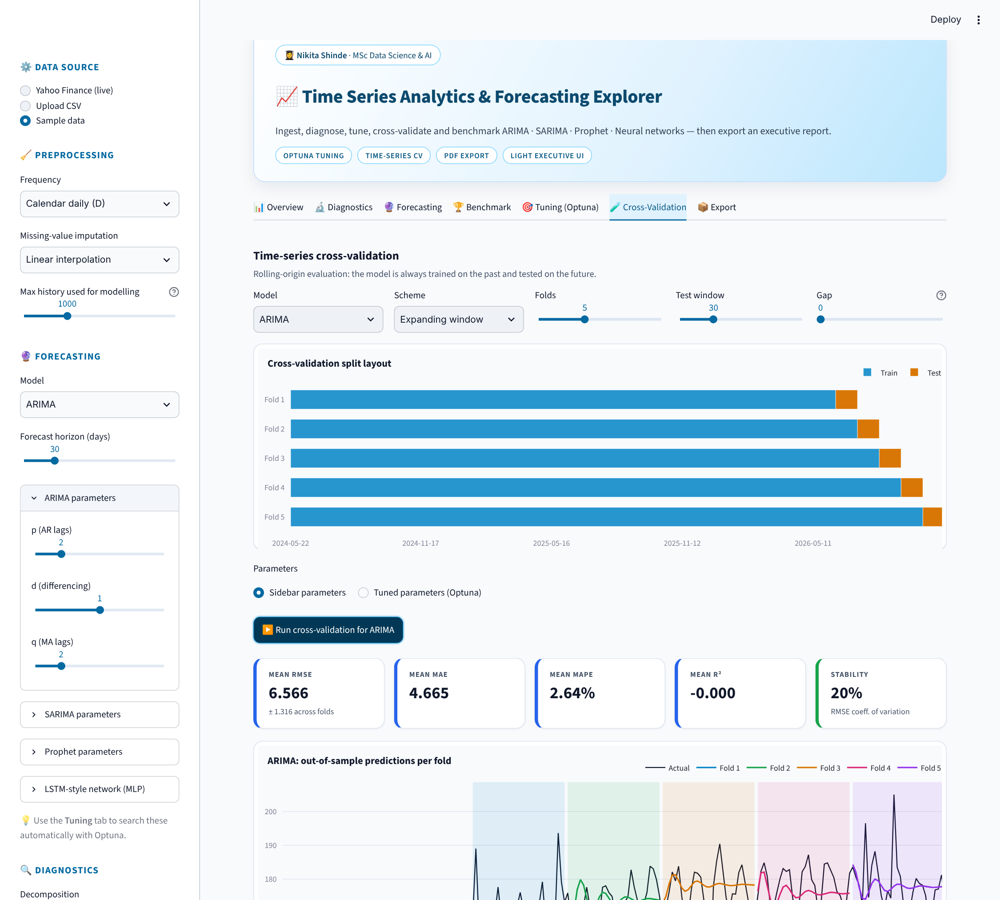
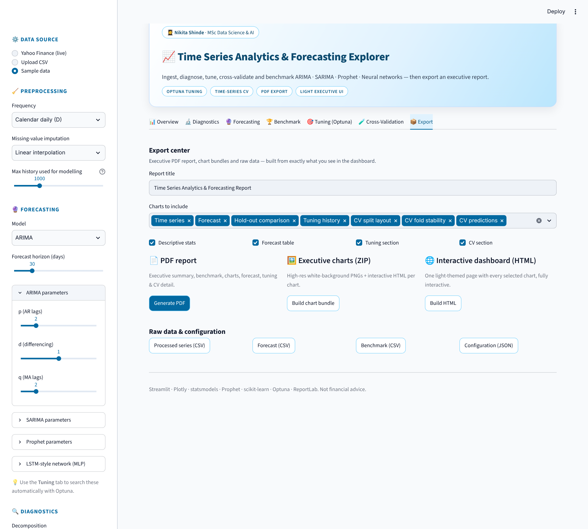

# 📈 Time Series Analytics & Forecasting Explorer

An interactive **Streamlit** dashboard for daily time-series analysis and forecasting. Load live market data or your own CSV, diagnose it statistically, compare **ARIMA, SARIMA, Prophet and a neural network (MLP)**, tune them automatically with **Optuna**, validate with **time-series cross-validation**, and export an **executive PDF report**.

**Built by Nikita Shinde · MSc Data Science & AI**



## ✨ Features

| Area | What it does |
|---|---|
| **Data** | Yahoo Finance (e.g. `AAPL`, `BTC-USD`), CSV upload, or built-in sample data; missing-value imputation |
| **Diagnostics** | ADF stationarity test, descriptive stats, additive / multiplicative trend–seasonal decomposition, IQR / rolling Z-score anomaly detection, distribution + KDE, ACF / PACF |
| **Forecasting** | ARIMA, SARIMA, Prophet, MLP neural network, with adjustable hyper-parameters and 95% confidence bands |
| **Benchmarking** | RMSE, MAE, MAPE, R² for all models side by side; best model highlighted automatically |
| **Optuna tuning** | Two-stage search (explore, then refine around the best trials), fold-level pruning, tuned-vs-baseline check on an untouched hold-out |
| **Cross-validation** | Expanding / sliding window splits, split-layout view, per-fold forecasts, stability, residuals, error vs horizon |
| **Export** | PDF report, PNG chart bundle (ZIP), interactive HTML dashboard, CSV / JSON downloads |
| **Engineering** | Modular package, error boundaries around every model and tab, cached computation, light executive UI |

## 🖼️ Screenshots

| Diagnostics | Forecasting |
|---|---|
|  |  |
| **Benchmark** | **Optuna tuning** |
|  |  |
| **Cross-validation** | **Export centre** |
|  |  |

## 🚀 Run locally

```bash
git clone https://github.com/nikitashinde08/time-series-forecasting-dashboard.git
cd time-series-forecasting-dashboard
python -m venv venv
venv\Scripts\activate          # Windows   (macOS/Linux: source venv/bin/activate)
pip install -r requirements.txt
streamlit run app.py
```

Open http://localhost:8501 and start with **Sample data** in the sidebar.

## 🗂️ Project structure

```
app.py              # entry point
tsa/
  config.py         # palette, model names, search spaces, author credit
  data.py           # Yahoo / CSV / sample data + preprocessing
  diagnostics.py    # ADF, stats, anomaly detection
  models.py         # ARIMA, SARIMA, Prophet, MLP forecasters
  tuning.py         # Optuna multi-stage tuning
  cv.py             # time-series cross-validation
  plots.py          # Plotly figures
  report.py         # PDF / ZIP / HTML export
  sidebar.py, views.py, ui.py, styles.py
.streamlit/config.toml   # light theme
```

## ⚠️ Notes

- The "LSTM" option is a **lightweight MLP over a sliding window** (scikit-learn), not a recurrent LSTM. Its confidence band is an approximation.
- PNG charts in the PDF/ZIP need Chrome for Kaleido. If missing, run `plotly_get_chrome` once; the app still works without it.
- Prophet needs a working `cmdstanpy` backend; if it fails the app shows a message and the other models keep running.
- Metrics come from rolling hold-out / CV on one series; treat rankings as indicative. Not financial advice.

## 🧰 Tech stack
Python · Streamlit · Plotly · statsmodels · Prophet · scikit-learn · Optuna · ReportLab · yfinance
